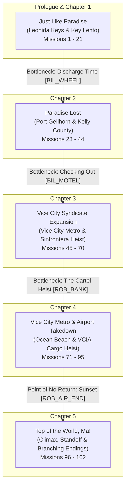
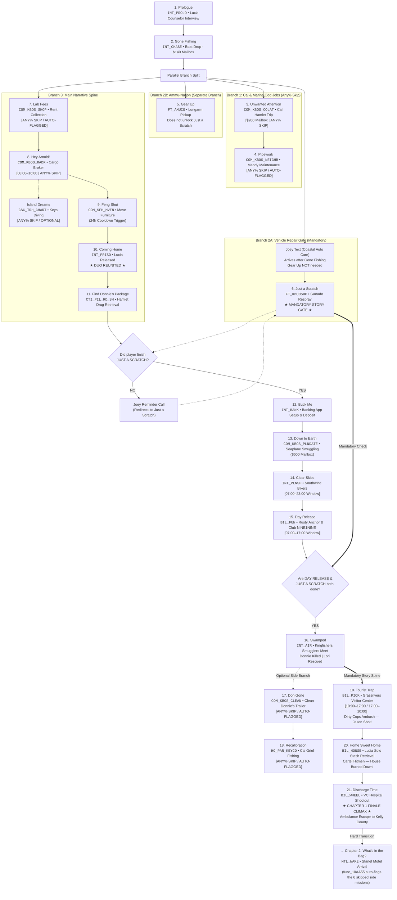
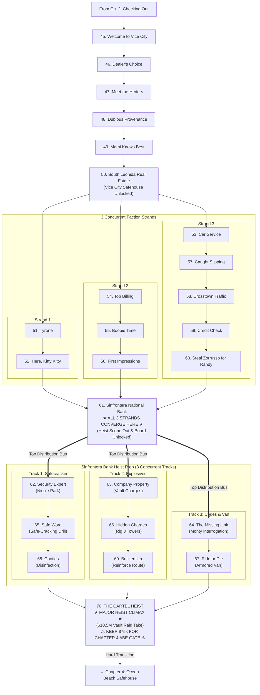
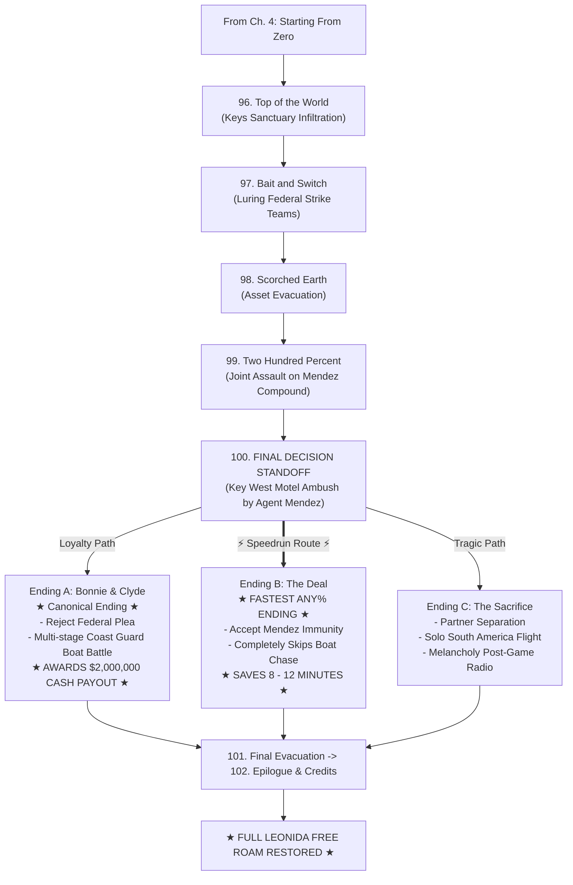

# Grand Theft Auto VI: Campaign Mission Flow & Prerequisite Guide

This document provides the definitive mission dependency graph, prerequisite unlock trees, character-switching milestones, heist setup pipelines, points of no return, and speedrun routing across all 5 story chapters of *Grand Theft Auto VI* based on verified data from **Build 1.0.2.1**.

---

## 1. High-Level Campaign Architecture

The GTA VI storyline progresses through five distinct geographical and thematic narrative blocks. While open-world exploration is available between operations, missions operate in a strict Directed Acyclic Graph (DAG) with key narrative bottlenecks connecting each chapter.

---

## 2. Chapter 1: Just Like Paradise (Leonida Keys)

### Mechanics & Structure
- **Playable Character**: Strictly locked to **Jason** for early operations, introducing **Lucia** in the Prologue, reuniting in *"Coming Home"*, featuring a solo mission for Lucia in *"Home Sweet Home"*, and concluding with the joint hospital escape in *"Discharge Time"*.
- **Total Missions**: **21 main and side-strand missions** (`replay_menu_position` 0–21 / `story_list_order` 0–22 in `mission_order.json`).
- **Core Narrative**: Petty smuggling, local debt enforcement for Brian, and settling in Key Lento following Lucia's release from Hamlet State Penitentiary, culminating in a violent clash with the Kingfishers, Donnie's death, a botched bag pickup at Grassrivers Visitor Center, the burning of their Hamlet house, and a desperate shootout escape from Vice City Hospital.
- **Parallel Multi-Branch Architecture**: After completing *"Gone Fishing"* ($140 mailbox cash pickup), the storyline opens concurrent tracks:
  1. **Branch 1 (Cal & Brian Marina Jobs)**: *Unwanted Attention* (`COM_KBOS_COLAT` - $200 mailbox cash pickup) $\rightarrow$ *Pipework* (`COM_KBOS_NEIGHB`). *(Both verified Any% skips auto-flagged by `func_10AA55`)*.
  2. **Branch 2A (Vehicle Repair Gate)**: *Just a Scratch* (`FT_KMODSHP` - Ganado repair & respray; **Mandatory Story Gate**). Opened by Joey's text (`0xC1CF23C9`: *"Hey this is Joey from Coastal Auto Care. Cal mentioned your car might need some work, let me know. Here's my spot."*), which arrives after *Gone Fishing* and does **not** require *Gear Up*. Source: in-game community testing; the game files contain no link between `FT_AMUCO` and `FT_KMODSHP` (no script references both, apart from the shared dispatcher's ID list).
  3. **Branch 2B (Ammu-Nation)**: *Gear Up* (`FT_AMUCO` - longarm pickup). Separate branch off *Gone Fishing*; it does **not** unlock Joey's text or *Just a Scratch*.
  4. **Branch 3 (Rent Collection & Main Spine)**: *Lab Fees* (`COM_KBOS_SHOP` - Any% skip) $\rightarrow$ *Hey Arnold!* (`COM_KBOS_RADR` - 08:00–16:00 window, Any% skip) $\rightarrow$ *Feng Shui* (`COM_SFH_MVFN` - triggers mandatory 24h wait) $\rightarrow$ *Coming Home* (`INT_PRISO` - Lucia released from prison) $\rightarrow$ *Find Donnie's Package* (`CTI_PIL_RD_SH`).
- **Unattributed lock string**: the text table also holds `0x2A09A6FD` (*"Complete Gone Fishing to unlock."*), but no script or data reference tying it to a specific mission was recovered, so it is not used as evidence for Branch 2A.
- **Sub-Branch: Island Dreams (`CSC_TRH_CHART`)**: Unlocked via Kenton's call during *Hey Arnold!*. Optional shipwreck treasure diving side mission (**Any% Skip**).
- **Decision Diamond 1 (Gate Check)**: Evaluates whether the player has completed *Just a Scratch*. If not completed, Joey places an urgent reminder call redirecting Jason back to clear the repair shop gate before *Buck Me* unlocks.
- **Decision Diamond 2 (Smuggler Gate Check)**: Evaluates whether BOTH *Day Release* (`BIL_FUN` - 07:00–17:00 window) AND *Just a Scratch* (`FT_KMODSHP`) are completed before Brian's call triggers *Swamped*.
- **The Chapter 1 Climax Gauntlet (M16–M21)**:
  - **16. Swamped (`INT_AIR`)**: Jason, Brian, and Lori confront the Kingfishers. Donnie is killed, Lori is taken hostage and rescued in the Grassrivers, and Brian retires from smuggling.
  - **Side Branch off Donnie's Death (Any% Skips)**:
    - **17. Don Gone (`COM_KBOS_CLEAN`)**: Brian asks Jason to clean out Donnie's trailer. Exact `0DRP` title is **`Don Gone`**, not "Doin' Gone". *(Auto-flagged by `func_10AA55`)*.
    - **18. Recalibration (`HO_PAR_KEYCO`)**: Jason and Lucia take a grieving Cal fishing after Donnie's death. *(Auto-flagged by `func_10AA55`)*.
  - **Main Story Climax Sequence (Mandatory)**:
    - **19. Tourist Trap (`BIL_PICK`)**: Disguised pickup from a locker at Grassrivers Visitor Center. Has day (`BIL_PICK_DAY_TIME_START` 10:00–17:00) and night (`BIL_PICK_NIGHT_TIME_START` 17:00–10:00) triggers. Ambushed by dirty cops; Jason is critically shot! Cal rushes Jason to Vice City Hospital.
    - **20. Home Sweet Home (`BIL_HOUSE`)**: Lucia returns solo to their Hamlet home to retrieve Jason's stash. Ambushed by masked cartel hitmen; Lucia escapes but their home is burned to the ground.
    - **21. Discharge Time (`BIL_WHEEL`)**: **★ TRUE CHAPTER 1 CLIMAX FINALE ★**. Lucia infiltrates Vice City Hospital to save Jason. They fight through dirty cops and cartel gunmen, hijack an ambulance, and flee west across the county line into Port Gellhorn.
- **Transition to Chapter 2 (`MTL_WAKE`)**: Hard cut to Starlet Motel. When `MTL_WAKE` starts, script handler `func_10AA55` sets the completion flags listed below.

### The 6 Verified Any% Skippable Missions (Auto-Flagged by `func_10AA55`)
In `0xD2601E252151E04B.ysc.cs:572964-573008`, when `MTL_WAKE` (0x3C9B93B4) is flagged, the game sets nine completion flags. Six of them are full Chapter 1 side missions:
1. **Lab Fees** (`COM_KBOS_SHOP`, Hash `0x2D7D2164`)
2. **Unwanted Attention** (`COM_KBOS_COLAT`, Hash `0x5AE70594`)
3. **Pipework** (`COM_KBOS_NEIGHB`, Hash `0xC8513199`)
4. **Hey Arnold!** (`COM_KBOS_RADR`, Hash `0x21D03E4F`)
5. **Don Gone** (`COM_KBOS_CLEAN`, Hash `0x10BE4C94`)
6. **Recalibration** (`HO_PAR_KEYCO`, Hash `0x420623AF`)

The other three flags set by the same sweep:
- **Just a Scratch** (`FT_KMODSHP_SECOND`, Hash `0xE48C934A`) — the `_SECOND` variant only; `FT_KMODSHP_FIRST` (`0xD244CB70`) is not in the sweep.
- **Donnie's Drop** ×2 (`RecoverDropTipShackDonnieAlive`, Hash `0x0094C57A`; `RecoverDropTipShackDonnieDeadUnknown`, Hash `0xEAB842AC`).

**Island Dreams** (`CSC_TRH_CHART`, Hash `0x617A1865`) is **not** in this sweep. The chart treats it as an optional side mission (Any% skip), but nothing in the game files auto-flags it.

---

## 3. Chapter 2: Paradise Lost (Port Gellhorn & Kelly County)

### Mechanics & Structure
- **Playable Character**: Heavily centered on **Lucia** during early recovery, then **permanently unlocks Dual Character Switching** via *"Coffee Break"*.
- **Vehicle Fencing**: Unlocked via *"Moses"* (enabling Slim Jim vehicle thefts and custom garage registrations).
- **Strict Chronological Sequence**: Organized into **4 sequential stages** that must be cleared in order (M23 through M44).
  - **Stage 1: Motel Arrival & Medical (M23–M28)**: Infiltration, paying upkeep, Lucia solo medical run, and establishing fencing with Moses.
  - **Stage 2: Debt Hustle & Gun Runs (M29–M37)**: Disguise setups, ambulance chasing, painkiller supply lines, and corner meetups.
  - **Stage 3: Dual Character Switching & Robberies (M38–M40)**: *Coffee Break* unlocks instant partner switching; *Hit Avery Pawn* introduces business robberies.
  - **Stage 4: Highway Escape & Move to Vice City (M41–M44)**: Vehicle recovery, Kelly County smugglers, and the motel evacuation climax in *Checking Out*.

```mermaid
flowchart TD
    C1_Trans["From Ch. 1: Discharge Time [BIL_WHEEL]"] --> S1_Start
    
    subgraph S1["Stage 1: Motel Arrival & Fencing (M23 - M28)"]
        S1_Start["23. What's in the Bag?<br/>(Starlet Motel Arrival)"] --> M24["24. Overnight Charges"]
        M24 --> M25["25. Take Care of Jason<br/>(Lucia Solo Medical Run)"]
        M25 --> M26["26. Just Moved In"]
        M26 --> M27["27. Girls' Trip"]
        M27 --> M28["28. Moses<br/>(Vehicle Fencing Unlocked)"]
    end
    
    M28 -->|"Stage 1 Complete"| S2_Start
    
    subgraph S2["Stage 2: Debt Hustle & Gun Runs (M29 - M37)"]
        S2_Start["29. New Look -> 30. How Do I Look?"] --> M31["31. Behind on Payments"]
        M31 --> M32["32. Ambulance Chaser"]
        M32 --> M33["33. Painkiller Supplier"]
        M33 --> M34["34. Daily Driver -> 35. Pick Up A Gun"]
        M34 --> M36["36. Slam Dunk -> 37. Breakfast Run"]
    end
    
    M36 -->|"Stage 2 Complete"| S3_Start
    
    subgraph S3["Stage 3: Dual Character Switching (M38 - M40)"]
        S3_Start["38. Coffee Break<br/>★ DUAL CHARACTER SWITCHING UNLOCKED ★"] --> M39["39. Hit Avery Pawn<br/>(Robbery Mechanic Active)"]
        M39 --> M40["40. Hit Kingpin Bowling<br/>(Optional / Skip in Any%)"]
    end
    
    M40 -->|"Stage 3 Complete"| S4_Start
    
    subgraph S4["Stage 4: Highway Escape & Move to VC (M41 - M44)"]
        S4_Start["41. Impounded Vehicle"] --> M42["42. Afternoon Delight"]
        M42 --> M43["43. Prepare for Vice City"]
        M43 --> M44["44. Checking Out<br/>★ CHAPTER 2 CLIMAX ★<br/>(Port Gellhorn Evacuation)"]
    end
    
    M44 -->|"Hard Transition"| C3_Start["→ Chapter 3: Welcome to Vice City"]
```

---

## 4. Chapter 3: Vice City Syndicate Expansion & Bank Heist

### Mechanics & Structure
- **Scope**: 26 main story operations (M45 through M70).
- **Safehouse Spine (M45–M50)**: Infiltration into the metropolis culminates in *South Leonida Real Estate*, opening the primary Vice City safehouse.
- **The 3 Parallel Alliance Strands**: Upon unlocking the safehouse, three major syndicate storylines open concurrently:
  1. **Strand 1: Tyrone (Street Muscle)**: Missions 51 & 52 (*Tyrone* $\rightarrow$ *Here, Kitty Kitty*).
  2. **Strand 2: Boobie Ike & Dre'Quan (Syndicate)**: Missions 54, 55, & 56 (*Top Billing* $\rightarrow$ *Boobie Time* $\rightarrow$ *First Impressions*).
  3. **Strand 3: Raul Bautista & Randy (Cartel Logistics & Cars)**: Missions 53, 57, 58, 59, & 60 (*Car Service* $\rightarrow$ *Caught Slipping* $\rightarrow$ *Crosstown Traffic* $\rightarrow$ *Credit Check* $\rightarrow$ *Steal Zorrusso for Randy*).
- **Convergence at Heist Scope Out (M61)**: All 3 strands converge into *Sinfrontera National Bank*.
- **The 3 Concurrent Heist Preparation Tracks**: Scope out unlocks the heist planning board, distributing prep work into 3 simultaneous tracks:
  - **Track 1: Safecracker Pipeline**: *62. Security Expert* (Nicole Park) $\rightarrow$ *65. Safe Word* (Drill) $\rightarrow$ *68. Cooties* (Disinfection).
  - **Track 2: Explosives Pipeline**: *63. Company Property* (Charges) $\rightarrow$ *66. Hidden Charges* (Cell Towers) $\rightarrow$ *69. Bricked Up* (Armor Route).
  - **Track 3: Codes & Van Pipeline**: *64. The Missing Link* (Monty Interrogation) $\rightarrow$ *67. Ride or Die* (Armored Van).
- **The Heist Finale (M70)**: *The Cartel Heist* ($10.5M Take). 
- **CRITICAL SPEEDRUN REQUIREMENT**: Runners **MUST retain at least $75,000 cash** in their BuckMe account to clear Abe Gonzalez's mandatory wire gate in Chapter 4!

---

## 5. Chapter 4: Vice City Metro & Airport Takedown

### Mechanics & Structure
- **Scope**: 25 main missions (M71 through M95).
- **Safehouse**: Y Hotel (Ocean Beach headquarters).
- **Mandatory Cash Gate (M75)**: In *Party Hard*, corrupt lawyer Abe Gonzalez demands a mandatory **$75,000 BuckMe wire transfer** to proceed.
- **Strict Chronological Sequence**:
  - **Stage 1: Beachhead & Abe Gate (M71–M75)**: Establishing Ocean Beach lifestyle and securing legal immunity.
  - **Stage 2: Syndicate Operations (M76–M82)**: Harbor smuggling, blackmail photography, fitness front extortion, and body sanitization.
  - **Stage 3: Dre'Quan Climax & Airport Recon (M83–M91)**: Celebrity protection, kidnapping, Dre'Quan concert finale (*Headliners*), and VCIA airport perimeter surveillance.
  - **Stage 4: Airport Heist & Evacuation (M92–M95)**: Cargo infiltration (*Fully Catered*), the massive airport heist (*VCIA Takedown*), open-world lockdown (*Sunset*), and emergency evacuation (*Starting From Zero*).
- **POINT OF NO RETURN**: *"Sunset"* permanently locks open-world activities and free roam saves, forcing continuous progression into Chapter 5.

```mermaid
flowchart TD
    C3_Trans["From Ch. 3: The Cartel Heist"] --> S1_Start
    
    subgraph C4_S1["Stage 1: Beachhead & $75k Gate (M71 - M75)"]
        S1_Start["71. Ocean Beach<br/>(Y Hotel Safehouse)"] --> M72["72. Another Life"]
        M72 --> M73["73. Company Cars"]
        M73 --> M74["74. Lawyer Up<br/>(Abe Gonzalez Consultation)"]
        M74 --> M75["75. Party Hard<br/>⚠️ MANDATORY $75,000 BUCKME WIRE ⚠️"]
    end
    
    M75 -->|"Stage 1 Complete"| S2_Start
    
    subgraph C4_S2["Stage 2: Syndicate Ops (M76 - M82)"]
        S2_Start["76. Heavy Lifting<br/>(Container Smuggling)"] --> M77["77. Photo/Shoot"]
        M77 --> M78["78. Making Gainz"]
        M78 --> M79["79. Watch It"]
        M79 --> M80["80. Cash Injections"]
        M80 --> M81["81. Amateur Hour"]
        M81 --> M82["82. Dirty Work<br/>(Sanitizing Murder Scene)"]
    end
    
    M82 -->|"Stage 2 Complete"| S3_Start
    
    subgraph C4_S3["Stage 3: Dre'Quan Climax & Airport Recon (M83 - M91)"]
        S3_Start["83. Too Much Baggage<br/>(Airport Courier Recon)"] --> M84["84. Adventures in Babysitting"]
        M84 --> M85["85. Fresh Evidence"]
        M85 --> M86["86. Power Play"]
        M86 --> M87["87. Child's Play"]
        M87 --> M88["88. Headliners<br/>(Dre'Quan Syndicate Climax)"]
        M88 --> M89["89. Close Surveillance -> 91. Team Building<br/>(VCIA Perimeter Intel)"]
    end
    
    M89 -->|"Stage 3 Complete"| S4_Start
    
    subgraph C4_S4["Stage 4: VCIA Heist & Evacuation (M92 - M95)"]
        S4_Start["92. Fully Catered<br/>(Catering Van Smuggling)"] --> M93["93. VCIA TAKEDOWN<br/>★ MAJOR AIRPORT CARGO HEIST ★"]
        M93 --> M94["94. Sunset<br/>🚨 POINT OF NO RETURN 🚨<br/>(Open-World Roaming Locked)"]
        M94 --> M95["95. Starting From Zero<br/>(Chapter 4 Climax Evacuation)"]
    end
    
    M95 -->|"Hard Transition"| C5_Start["→ Chapter 5: Top of the World"]
```

---

## 6. Chapter 5: Top of the World, Ma! (Climax & Branching Endings)

### Mechanics & Structure
- **Scope**: 7 explosive endgame operations (M96 through M102).
- **The Standoff Decision (Mission 100)**: At the Key West Motel, Agent Mendez surrounds Jason and Lucia, triggering the critical campaign finale fork:
  - **Ending A: Bonnie & Clyde (Canonical Partner Loyalty)**:
    - Jason and Lucia reject the federal plea and fight side-by-side against Mendez's tactical strike teams.
    - Requires fighting through an extended multi-stage offshore Coast Guard gunboat pursuit to reach an airstrip.
    - **Reward**: **Awards a $2,000,000 completion payout** into the player's account. (*Note: $2M is an earned reward, NOT a requirement to start!*)
  - **Ending B: The Deal (⚡ ANY% SPEEDRUN ROUTE ⚡)**:
    - One partner accepts Agent Mendez's federal immunity agreement.
    - **Bypasses the entire multi-stage offshore boat chase**, saving **8 to 12 minutes of real-world runner time**.
  - **Ending C: The Sacrifice (Partner Separation)**:
    - One partner acts as bait while the other evacuates solo to South America. Triggers unique melancholy post-game radio commentary.
- **Epilogue & Free Roam Restored (M101–M102)**: Free roam across the entire Leonida map is unlocked following the credits.

---

## 7. Prerequisite & Unlock Reference Matrix (Build 1.0.2.1 Ground Truth)

| Chapter | Mission Title (Exact 0DRP) | Internal ID | Protagonist & Trigger Window | Mandatory Prerequisite | Unlocked Feature / Story Consequence | Speedrun Advisory |
| :--- | :--- | :--- | :--- | :--- | :--- | :--- |
| **Ch. 1** | **1. Prologue** | `INT_PROLO` | Lucia | Game Launch | Introduces Lucia in Hamlet Penitentiary interview | Unskippable intro cutscene |
| **Ch. 1** | **2. Gone Fishing** | `INT_CHASE` | Jason | 1. Prologue | Petty smuggling; splits story into parallel branches | Grab $140 mailbox immediately |
| **Ch. 1** | **3. Unwanted Attention** | `COM_KBOS_COLAT` | Jason | 2. Gone Fishing | Cal Hamlet trip; recovers car from impound | **ANY% SKIP** (Auto-flagged by `MTL_WAKE`) |
| **Ch. 1** | **4. Pipework** | `COM_KBOS_NEIGHB` | Jason | 3. Unwanted Attention | Mandy rent collection & home plumbing repairs | **ANY% SKIP** (Auto-flagged by `MTL_WAKE`) |
| **Ch. 1** | **5. Gear Up** | `FT_AMUCO` | Jason | 2. Gone Fishing | Picks up longarm gun at Ammu-Nation | Separate branch; **not** required for Just a Scratch |
| **Ch. 1** | **6. Just a Scratch** | `FT_KMODSHP` | Jason | 2. Gone Fishing (Joey's text) | Ganado repair & respray; **MANDATORY STORY GATE** | Complete early to prevent Joey reroute call |
| **Ch. 1** | **7. Lab Fees** | `COM_KBOS_SHOP` | Jason | 2. Gone Fishing | Acid front boutique rent collection | **ANY% SKIP** (Auto-flagged by `MTL_WAKE`) |
| **Ch. 1** | **8. Hey Arnold!** | `COM_KBOS_RADR` | Jason (08:00–16:00) | 7. Lab Fees | Tracks down cargo broker Arnold | **ANY% SKIP** (Auto-flagged by `MTL_WAKE`) |
| **Ch. 1** | **Island Dreams** | `CSC_TRH_CHART` | Jason | 8. Hey Arnold! (Kenton) | Shipwreck dive with bachelor party | **ANY% SKIP** (Optional side activity) |
| **Ch. 1** | **9. Feng Shui** | `COM_SFH_MVFN` | Jason | 8. Hey Arnold! | Rearranges furniture; triggers mandatory 24h wait | Run Branch 1 during 24h cooldown |
| **Ch. 1** | **10. Coming Home** | `INT_PRISO` | Jason & Lucia | 9. Feng Shui | Lucia released from prison; duo reunited in Key Lento | Hot meter unlocked; skip clothing chores |
| **Ch. 1** | **11. Find Donnie's Package** | `CTI_PIL_RD_SH` | Jason | 10. Coming Home | Swamps package recovery; leads to Diamond 1 | Prerequisite for Decision Diamond 1 |
| **Ch. 1** | **12. Buck Me** | `INT_BANK` | Jason & Lucia | 11 + Diamond 1 Gate | Mobile banking app and money deposits unlocked | Set up account for later heist & wire gates |
| **Ch. 1** | **13. Down to Earth** | `COM_KBOS_PLNDATE` | Jason & Lucia | 12. Buck Me | Seaplane smuggling run with Lucia | Grab $600 mailbox cash |
| **Ch. 1** | **14. Clear Skies** | `INT_PLNSH` | Jason (07:00–23:00) | 13. Down to Earth | Donnie smuggler plane escort & Southwind biker shootout | Mind 07:00–23:00 trigger window |
| **Ch. 1** | **15. Day Release** | `BIL_FUN` | Jason & Lucia (07:00–17:00)| 14. Clear Skies | Rusty Anchor, yacht party, Club NINE1NINE | Leads to Decision Diamond 2 |
| **Ch. 1** | **16. Swamped** | `INT_AIR` | Jason & Brian & Lori | Diamond 2 Gate (15 + 6) | Kingfishers ambush; Donnie killed, Brian retires | Sets up Donnie death aftermath |
| **Ch. 1** | **17. Don Gone** | `COM_KBOS_CLEAN` | Jason | 16. Swamped | Cleans Donnie's trailer to cover Brian's link | **ANY% SKIP** (Auto-flagged by `MTL_WAKE`) |
| **Ch. 1** | **18. Recalibration** | `HO_PAR_KEYCO` | Jason & Lucia | 17. Don Gone | Cal grief fishing trip after Donnie's death | **ANY% SKIP** (Auto-flagged by `MTL_WAKE`) |
| **Ch. 1** | **19. Tourist Trap** | `BIL_PICK` | Jason & Lucia (10:00–17:00 / 17:00–10:00) | 16. Swamped | Grassrivers Visitor Center locker pickup; Jason shot! | Mandatory main story gauntlet |
| **Ch. 1** | **20. Home Sweet Home** | `BIL_HOUSE` | Lucia Solo | 19. Tourist Trap | Hamlet house stash retrieval; house burned down | Mandatory Lucia solo gauntlet |
| **Ch. 1** | **21. Discharge Time** | `BIL_WHEEL` | Lucia & Jason | 20. Home Sweet Home | **★ CHAPTER 1 FINALE CLIMAX ★**; VC Hospital escape | Hard transition cut to Port Gellhorn |
| **Ch. 2** | **23. What's in the Bag?** | `MTL_WAKE` | Joint | 21. Discharge Time | Starlet Motel arrival; inspects statue & drive | Auto-flags 6 Ch. 1 side missions, `FT_KMODSHP_SECOND` and Donnie's Drop ×2 |
| **Ch. 2** | **25. Take Care of Jason** | `MTL_CHECK` | Lucia Solo | 24. Overnight Charges | Lucia solo medical supplies run | Focus on driving lines; no wasted exploration |
| **Ch. 2** | **28. Moses** | `COM_MECH_INTR` | Lucia Solo | 27. Girls' Trip | Vehicle fencing & custom garage registration | Fencing active; skip unnecessary joyriding |
| **Ch. 2** | **38. Coffee Break** | `MTL_SWTCH` | Dual Switching | 37. Breakfast Run | **PERMANENTLY UNLOCKS DUAL CHARACTER SWITCHING** | Major Any% milestone; optimal switching saves time |
| **Ch. 2** | **39. Hit Avery Pawn** | `ROB_PAWN` | Dual Switching | 38. Coffee Break | Commercial robbery mechanic unlocked | Mandatory tutorial heist; fast cash grab |
| **Ch. 2** | **40. Hit Kingpin Bowling** | `MTL_MONT` | Dual Switching | 39. Hit Avery Pawn | Kelly County robbery opportunity | **SKIP in Any%** (non-mandatory side robbery) |
| **Ch. 2** | **44. Checking Out** | `BIL_MOTEL` | Dual Switching | 43. Prepare for VC | Evacuates motel; **Chapter 2 Story Climax** | Hard transition cut to Vice City |
| **Ch. 3** | **50. Real Estate** | `SFH_BUY` | Dual Switching | 49. Mami Knows Best | Vice City safehouse; unlocks 3 concurrent strands | Core syndicate hub unlocked |
| **Ch. 3** | **51–52. Tyrone Strand** | `TYR_INTRO` | Dual Switching | 50. Real Estate | Street muscle contracts | Interleave with Boobie & Raul to avoid cooldowns |
| **Ch. 3** | **54–56. Boobie Strand** | `CLB_INTRO` | Dual Switching | 50. Real Estate | Nightclub and Port of Vice City introductions | High syndicate reputation unlocked |
| **Ch. 3** | **53, 57–60. Raul Strand**| `CAR_INTRO` | Dual Switching | 50. Real Estate | Cartel logistics and exotic car booster contracts | Unlocks Zorrusso supercar getaway vehicle |
| **Ch. 3** | **61. Sinfrontera Scope Out**| `ROB_PREP_SCOP` | Dual Switching | M52, M56, and M60 | Convergence point; unlocks Heist Planning Board | Opens 3 concurrent preparation tracks |
| **Ch. 3** | **62, 65, 68 (Safecracker)**| `ROB_PREP_CRCK` | Dual Switching | 61. Heist Scope Out | Track 1: Nicole Park, safe drill, disinfection | Execute concurrently with Tracks 2 & 3 |
| **Ch. 3** | **63, 66, 69 (Explosives)** | `ROB_PREP_EXPL` | Dual Switching | 61. Heist Scope Out | Track 2: Vault charges, cell towers, route reinforcement | Rigging towers delays SWAT response in heist |
| **Ch. 3** | **64, 67 (Codes & Van)** | `ROB_PREP_VANS` | Dual Switching | 61. Heist Scope Out | Track 3: Monty codes, armored extraction van | Van ensures bulletproof extraction route |
| **Ch. 3** | **70. The Cartel Heist** | `ROB_BANK` | Dual Switching | All 8 prep missions | **Sinfrontera Bank Vault Raid ($10.5M Take)** | **RETAIN $\ge\$75,000 CASH FOR CHAPTER 4!** |
| **Ch. 4** | **71. Ocean Beach** | `SFH_BEACH` | Dual Switching | 70. The Cartel Heist | Establishes Y Hotel safehouse | Fast oceanfront spawn point |
| **Ch. 4** | **75. Party Hard** | `LAW_WIRE` | Dual Switching | 74. Lawyer Up | Corrupt lawyer Abe Gonzalez legal immunity | **$75k BuckMe wire gate** (instant pass if cash saved) |
| **Ch. 4** | **88. Headliners** | `DRE_CONCERT` | Dual Switching | 87. Child's Play | Dre'Quan concert finale; unlocks airport recon | Concludes Dre'Quan alliance arc |
| **Ch. 4** | **93. VCIA Takedown** | `ROB_AIR` | Dual Switching | 92. Fully Catered | **Major Airport Cargo Heist** | Awards *Hi-Jacked* trophy |
| **Ch. 4** | **94. Sunset** | `ROB_AIR_END` | Dual Switching | 93. VCIA Takedown | **POINT OF NO RETURN** | Locks open-world roaming and manual saves |
| **Ch. 4** | **95. Starting From Zero** | `EVAC_VC` | Dual Switching | 94. Sunset | Chapter 4 climax evacuation | Immediate continuation into Chapter 5 |
| **Ch. 5** | **99. Two Hundred Percent** | `END_ASSAULT` | Dual Switching | 98. Scorched Earth | Assault on Mendez compound | High-intensity tactical combat gauntlet |
| **Ch. 5** | **100. Standoff Decision** | `END_STAND` | Dual Switching | 99. Two Hundred Percent| Key West Motel ambush by Mendez | Choose Ending A, B, or C |
| **Ch. 5** | **Ending B: The Deal** | `END_IMMUNITY` | Dual Switching | 100. Standoff (Immunity)| Partner accepts federal plea | **FASTEST ANY% ROUTE (Saves 8–12 minutes)** |
| **Ch. 5** | **Ending A: Bonnie & Clyde** | `END_LOYALTY` | Dual Switching | 100. Standoff (Loyalty) | Partner trust; offshore Coast Guard battle | **Awards $2,000,000 cash payout** (Not a gate!) |
| **Ch. 5** | **101–102. Epilogue & Credits**| `END_CREDITS` | Dual Switching | Any Ending Selected | Campaign concluded; free roam restored | Full Leonida map unlocked for post-game |

---

## 8. Fact-Checking & Ground Truth Discrepancy Analysis

### 1. The True Chapter 1 Climax: *Discharge Time* vs. Truncated Community Outlines
Early community diagrams circulating online (such as `image_1188e9.jpg`) contained two significant errors:
1. **Misnaming and Premature Termination**:
   - `image_1188e9.jpg` mistakenly spelled mission 17 as `"Doin' Gone"` and assumed the chapter terminated immediately thereafter.
   - Decompiled text tables (`data.rpf @ 0x19be000`, `table_0019be000.json` key hash `0x10BE4C94`) confirm the exact title is **`Don Gone` (`COM_KBOS_CLEAN`)**, referring to cleaning out Donnie's trailer after his death in *Swamped*.
   - Chapter 1 does **not** end at *Don Gone*. Build 1.0.2.1 game data (`CMissions` table, `uiProgressDataset`, and `story000.rpf` mission list) proves that Chapter 1 contains four additional operations:
     - **`Recalibration` (`HO_PAR_KEYCO`)**: Cal grief fishing trip following Donnie's death.
     - **`Tourist Trap` (`BIL_PICK`)**: Mandatory Grassrivers Visitor Center locker pickup where Jason is critically shot.
     - **`Home Sweet Home` (`BIL_HOUSE`)**: Mandatory Lucia solo retrieval of Jason's stash in Hamlet while their house is torched.
     - **`Discharge Time` (`BIL_WHEEL`)**: **★ TRUE CHAPTER 1 FINALE CLIMAX ★**. Lucia infiltrates Vice City Hospital to extract wounded Jason, engaging dirty cops and cartel gunmen in an ambulance escape across county lines to Kelly County.
2. **The `func_10AA55` Auto-Flag Mechanism in `0xD2601E252151E04B.ysc.cs`**:
   - When Chapter 2 begins (*What's in the Bag?* / `MTL_WAKE`), `func_10AA55` automatically flags 6 side missions: `Lab Fees` (`COM_KBOS_SHOP`), `Unwanted Attention` (`COM_KBOS_COLAT`), `Pipework` (`COM_KBOS_NEIGHB`), `Hey Arnold!` (`COM_KBOS_RADR`), `Don Gone` (`COM_KBOS_CLEAN`), and `Recalibration` (`HO_PAR_KEYCO`). The same sweep also sets `FT_KMODSHP_SECOND` (*Just a Scratch*) and both *Donnie's Drop* flags. `Island Dreams` (`CSC_TRH_CHART`) is optional but is not part of the sweep.
   - This script mechanism is why early players who rushed the main story skipped straight from the hospital escape into the motel room without ever realizing they bypassed these side tasks.

### 2. The Ending A $2,000,000 Payout Clarification
- A common misconception in player communities is that Ending A (*Bonnie & Clyde*) requires $2,000,000 in the player's bank account to unlock.
- **Fact**: Script analysis confirms that **$2,000,000 is the mission completion cash reward** paid out to Jason and Lucia upon successfully surviving the Coast Guard gauntlet, NOT an entry prerequisite. Players do not need to grind money before initiating the finale.

### 3. Strict Sequential Progression vs. Concurrent Parallel Strands
- **Chapters 2 & 4 (Sequential Stages)**: Visual "wrap-around" diagonal arrows in older community flowcharts made Chapters 2 and 4 look like parallel faction branches. In reality, they are strict chronological stages (Stages 1 through 4) where each phase must be fully cleared before the next stage opens.
- **Chapter 3 (True Parallel Faction Strands)**: Once the Vice City safehouse is unlocked in Mission 50, Tyrone (Strand 1), Boobie (Strand 2), and Raul (Strand 3) are active simultaneously as concurrent map pins. Furthermore, the Sinfrontera Bank Heist features 3 concurrent preparation tracks (Safecracker, Explosives, Codes & Van) that can be tackled in any order.

### 4. Any% Speedrun Optimization Summary
- **Chapter 1 Downtime Optimization**: Skip the 6 auto-flagged side missions (`Lab Fees`, `Unwanted Attention`, `Pipework`, `Hey Arnold!`, `Don Gone`, `Recalibration`); the `MTL_WAKE` entry handler in `func_10AA55` flags them automatically. `Island Dreams` is also skipped as an optional side mission, but note that it is not auto-flagged.
- **Skip All Social / Hot Meter Activities**: Ignore *Get Haircut*, *Buy Necklace*, *Buy Flowers*, *Buy Groceries*, and *Lucia's Clothes*.
- **Save $75,000 Cash**: Keep at least $75,000 from the Sinfrontera Bank Heist ($10.5M take) to instantly bypass Abe Gonzalez's wire transfer gate in Chapter 4 (*Party Hard*).
- **Select Ending B (*The Deal*)**: Accepting Mendez's immunity plea skips the multi-stage offshore Coast Guard gunboat battle, saving **8 to 12 minutes of real-world time** in Any% speedruns.
