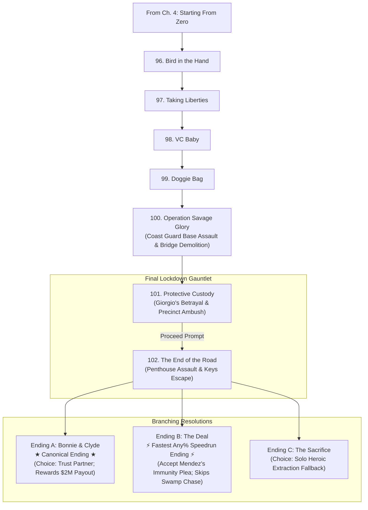

# Speedrun routing notes: build 1.0.2.1 (Xbox Series)

## Status

**The mission progression graph has not been reconstructed.** No mission prerequisite, trigger, or protagonist
requirement was recovered. What was recovered is a verified mission inventory, a chapter grouping from two
independent sources, the progress-menu display order, four replay-entry links, and a small set of flow facts
read from a separately supplied folder of decompiled scripts.

Do not route from these files as if they described unlock order. In `mission_order.json`, `null` means unknown.

**Readable mission titles are not available.** Neither the dump nor the decompiled scripts contain display text.
The names in these files are the game's internal mission IDs.

## What was recovered

| Finding | Source | Confidence |
|---|---|---|
| 145 mission table entries (ID, replay text key, grid texture) | `common.rpf` @ `0x219000`, XML root `CMissions` | Observed |
| 97 replay-menu entries under five chapter filters | `data.rpf` @ `0x12010000`, RBF0 root `uiProgressDataset`, category `missions_card` | Observed |
| Chapter grouping: 22 / 13 / 28 / 27 / 7 entries for chapters 1 to 5 | Menu filters `missions_chapter_1` to `_5` | Observed |
| Second chapter source: `CH1` to `CH5` tag in each grid texture name | `CMissions` `TextureName` | Observed, agrees for 87 of 92 comparable entries |
| Four replay entries keyed to another mission | Menu item `ID` differs from `UnlockId` | Observed, meaning inferred |
| Build version 1.0.2.1 | `appxmanifest.xml`, `MicrosoftGame.Config` | Observed |

The 97 menu entries and the 145 table rows overlap on 95 IDs. Two menu entries have no table row
(`CTI_PIL_RD_SH`, `MTL_AMBUL`) and 50 table rows have no menu entry.

## Decompiled script evidence

Source: `C:\Users\<user>\Downloads\americas_scripts_23_11_2026` (746 `.ysc.cs` files, 52.3 million lines, read
only). This folder is not part of the dump. Its link to this build is that the joaat hashes of 144 of the 145
`CMissions` IDs occur in it as constants, against 0 hits for 145 control strings.

| Finding | Where | Confidence |
|---|---|---|
| No display text. Strings appear only as `Vm.StringConstant(program, heapOffset)` (55 lines) and the heap is not in the folder; every quoted literal is decompiler vocabulary | All files, `Runtime\Vm.cs` | Observed |
| 196 scripts reference a mission ID; 177 of them reference exactly one | `work\decomp_mission_refs.json` | Observed |
| 95 of 97 replay-menu missions have at least one such script (not checked: `CTI_PIL_RD_SH`, `MTL_AMBUL`, which have no `CMissions` row) | `decompiled_mission_scripts_referencing_id` in the JSON | Observed |
| `func_109E09` returns 1 for 131 mission IDs. The 14 left out are mostly IDs that have variant rows (`AIR_CATER`, `AIR_FINAL`, `BIL_MOTEL`, `BIL_PENT`, `BIL_PICK`, `INT_PRISO`, `ROB_BOAT_J`, `FT_UP_MMRENT`, `ANT_INTRO`, `FT_AMUCO`, `FT_KMODSHP`, `COM_KBOS_PLNDATE`) plus `ANT_GIVE` and `CTI_PIL_RD_BC_PARENT` | `0xD2601E252151E04B.ysc.cs` lines 570880 to 572796 | Observed |
| `func_10AD05` returns true if the flag for `BIL_FINALE_M` **or** `BIL_FINAL_B` is set | Same file, lines 573115 and 573127 | Observed |
| `func_10AA55(id)` called with `MTL_WAKE` sets the flags of `FT_KMODSHP_SECOND`, `COM_KBOS_SHOP`, `COM_KBOS_COLAT`, `COM_KBOS_RADR`, `COM_KBOS_NEIGHB`, `COM_KBOS_CLEAN`, `HO_PAR_KEYCO`, `RecoverDropTipShackDonnieAlive`, `RecoverDropTipShackDonnieDeadUnknown` | Same file, lines 572964 to 573008 | Observed |
| `func_10AA55(id)` called with `MNY_HOTEL` or `MNY_HOTEL_AUTOLAUNCH` sets `ANT_SRCH` and `ANT_RECOV`; sets `ANT_CHASE` unless `ANT_CHASE_AUTOLAUNCH` or `ANT_CHASE` is already set; sets `ANT_INTRO_APARTMENT` unless `ANT_INTRO_APARTMENT` or `ANT_INTRO_STORAGE` is already set | Same file, lines 572946 to 573082 | Observed |
| `BIL_PICK_NIGHT_TIME_START` and `BIL_PICK_DAY_TIME_START` are passed to the same native with a boolean and its negation; the boolean includes a `< 17` comparison | `story000.ysc.cs` lines 116320 to 116328 | Observed |

"Flag" means the per-ID value written by `Virtual.type_37658EE3464E5234.Method_0(store, id, 1)` and read by
`Method_1`. The methods are unnamed. Reading the flag as "mission completed" is an **inference** from the ID names
and from `func_10AD05`; it is not proven. Whether `func_10AA55` runs at mission start or mission pass is unknown:
no direct call to it was found in the decompiled code, so it is presumably dispatched indirectly.

If that inference holds, it would mean the listed chapter 1 entries are closed out when `MTL_WAKE` (first entry of
the chapter 2 filter) is processed, the `ANT_*` entries are closed out when `MNY_HOTEL` (first entry of the
chapter 4 filter) is processed, and the story has two alternative final missions. Treat all three as leads to test,
not as routing facts.

Eight scripts reference IDs of more than one mission family. What each reference does was not determined:
`0x2CC10383B818622E` (`HO_PAR_FRINT`, `MTL_MUD`), `0x4C79572EA44F9250` (`AO_SHOW_L_EXP`,
`robbergetawaydriverprep`), `0x69B5F3FBB0807F99` (`COM_KBOS_COLAT`, `CTI_MECH_STFC`, `CTI_SHOW_HATH`),
`0x947D998BD81F7AC1` (`AIR_TAIL`, `CLB_EVI`, `FT_KMODSHP_FIRST`, `FT_KMODSHP_SECOND`), `0x96FAE5BE63A12676`
(`BIL_BOSS`, `COA_HELIS`), `0xCB466D0841607AEC` (`COM_MECH_INTR`, `COM_SFH_MVFN`), `0xCBB412F4549E13F9`
(`FT_MOTEL_SHOP`, `FT_UP_MMRENT_MANAGER_*`, `UP_MLSPM`), `0xD6DA4FF46709E305` (`INT_PLNSH`, `MTL_CONT`).

Not analysed: `func_12EB6F` (maps unnamed hashes to 17 mission IDs), `func_24BCE4` (registers a record for each
of 31 mission IDs), and the natives that take a mission ID (`_0x65F45909812A5248`, `_0x7191C011FD1040FD`,
`_0xB0584804833510A0`, `_0x480014E54CD33903`, `_0xC663AE0D5D968A80`), whose names are not in the decompilation.

## Structural topology summary

Unknown. The readable data contains no linear-versus-parallel information. The only structural hint is the pair
of alternative final-mission flags above.

- Menu order inside a chapter is a display order. `UniqueMissionIndex` is not chronological either: index 23 is
  tagged `CH3`, index 67 is `CH5`, and indices 98 and 99 are `CH3`.
- Mission entries use `uiUnlockEvaluatorMission` with no parameters, so the menu holds no condition expressions.

## Hard synchronization bottlenecks

None determinable. No mission could be shown to gate another.

## Speedrun-critical mechanics found in scripts

None confirmed. The dump's own script archives were not readable. The decompiled folder gave the flag facts in
the section above and nothing about phone-call delays, timers, fail-skip thresholds, or stat and cash gates.

The following are **names only**, taken from table rows that share a listed mission's ID as a prefix. They show
that variants exist. They do not show what triggers them or what they change.

| Listed mission | Variant table entries |
|---|---|
| `INT_PRISO` | `_TRIGGER_EARLY`, `_TRIGGER_LATE` |
| `BIL_PICK` | `_DAY_TIME_START`, `_NIGHT_TIME_START` |
| `MNY_HOTEL` | `_AUTOLAUNCH` |
| `MNY_KIDNP` | `_AUTO-LAUNCH` |
| `BIL_MOTEL` | `_NON_VIOLENT`, `_VIOLENT` |
| `AIR_FINAL` | `_DATA_HACK_FAILED`, `_DATA_HACK_PASSED` |
| `AIR_CATER` | `_DHF`, `_DHP`, `_DHS` |
| `BIL_PENT` | `_B_BRIAN`, `_M_MENDEZ` |
| `ROB_BOAT_J` | `_JASON` (a separate row `ROB_BOAT_L_LUCIA` also exists) |
| `FT_AMUCO` | `_FIRST_INTERACTION`, `_SECOND_INTERACTION` |
| `FT_KMODSHP` | `_FIRST`, `_SECOND` |
| `ANT_INTRO` | `_APARTMENT`, `_STORAGE` |
| `COM_KBOS_PLNDATE` | `_PLANE_N_DINNER_DATE` |

A further 27 table rows match no listed mission by prefix, including `ANT_CHASE_AUTOLAUNCH`, `BIL_FINALE_M`,
`BIL_FINAL_B`, `FIN_CONT`, `INT_CRED`, and four `FT_UP_MMRENT_MANAGER_*` rows. The full list is in
`cmissions_entries_not_in_replay_menu`.

## Replay-entry links

These are the only cross-mission relations in the readable data. In each case the menu entry's `UnlockId` names a
different mission than its own `ID`.

| Replay entry | `UnlockId` |
|---|---|
| `BIL_PICK` | `BIL_WHEEL` |
| `BIL_HOUSE` | `BIL_WHEEL` |
| `BAN_SETUP` | `BAN_RESCU` |
| `MNY_HOTEL` | `SFH_TAXI` |

This says which mission's state reveals a progress-menu entry. It is not evidence that one mission must be
completed before the other can start, and the direction of any in-game dependency is not established.

## Unresolved and ambiguous nodes

Every edge is unresolved. Specific ambiguities in the nodes themselves:

- **Chapter disagreements (5):** `CLB_MEET` (menu chapter 3, texture `CH2`), `SFH_TAXI` (4, `CH5`),
  `AO_SHOW_L_EXP` (4, `CH3`), `ROB_DEATH` (4, `CH5`), `BIL_CONFR` (4, `CH5`). The JSON uses the menu chapter.
  Three more menu entries have no `CH` tag to compare (`CSC_MOM_MSEVN`, `COM_DLR_COOK`, `COM_SHOW_TRAILER`).
- **Label names a different table ID (3):** `CTI_PIL_RD_SH` is labelled `CTI_PIL_RD_BC_PARENT`, `BAN_PKBMB` is
  labelled `FT_BAN_DISTR`, and `BIL_LAW` is labelled `COA_SHIP`.
- **Main story versus side content:** not classifiable. ID prefixes such as `COM_`, `CTI_`, `CSC_`, `FT_`, `HO_`,
  `AO_`, and `UP_` are unexplained, so no Any% mandatory count is given.
- **Display titles:** unavailable. Only text keys were found (for example `PROG_INT_CHASE_DESC_REPLAY`); no
  localized text table was readable, and the decompiled scripts carry no string heap. Titles in
  `gta 6 mission workflow charts\gta6_mission_flow_chart.md` and `GTAVI_MISSION_FLOW1.jpg` were checked against
  the dump: 3 of 145 candidate titles occur at all, and only as business or district names in location lists.

## Why the graph is not recoverable from this dump

| Blocker | Measured fact |
|---|---|
| No executable | `game_scarlett_master.exe` is named in the manifests but absent, so there is no key material or native table |
| Encrypted name tables | Every RPF9 table of contents is high-entropy; extracted files have offsets, not names |
| Hashed script identifiers | All 3,010 script PSO files use 32-bit hashes for every struct and member name |
| Encrypted script strings | All 2,971 `LSNS` blocks are exact multiples of 16 bytes and repeat across files, the signature of a fixed-key block cipher |
| Opaque script data | 52.2 MB of `story000_script.rpf` (67%, 31 regions) is neither zlib nor plaintext |
| No mission anchor in scripts | Hashes of the mission IDs hit 1,263 times in `data.rpf` (control: 2) but only 12 times in the script archives (chance: about 3) |

Two families of script object were identified but not interpreted: 701 small node-sequence graphs in `script.rpf`
            M53["53. Car Service"] --> M57["57. Caught Slipping"]
            M57 --> M58["58. Crosstown Traffic"]
            M58 --> M59["59. Credit Check"]
            M59 --> M60["60. Steal the Zorrusso for Randy"]
        end
    end
    
    M50 --> M51
    M50 --> M54
    M50 --> M53
    
    subgraph Heist_Prep["Sinfrontera Bank Heist Pipeline"]
        M52 & M56 & M60 --> M61["61. Sinfrontera National Bank<br/>(Heist Scope Out & Board Unlocked)"]
        
        M61 --> P1["62. Security Expert<br/>(Retrieve Nicole Park)"]
        M61 --> P2["63. Company Property<br/>(Steal Vault Explosives)"]
        M61 --> P3["64. The Missing Link<br/>(Interrogate Monty)"]
        
        P1 --> P4["65. Safe Word<br/>(Safe-Cracking Training)"]
        P2 --> P5["66. Hidden Charges<br/>(Rig 3 Cell Towers - Delays Police)"]
        
        P3 --> P6["67. Ride or Die"]
        P4 --> P7["68. Cooties"]
        P5 --> P8["69. Bricked Up"]
        
        P6 & P7 & P8 --> M70["70. The Cartel Heist<br/>(Sinfrontera Vault Score: $10.5M)"]
    end
```

---

## 5. Chapter 4: Vice City, Baby (The Syndicate & The Airport)

### Mechanics & Structure
- **Scope**: 25 main missions.
- **Safehouse**: Y Hotel (Ocean Beach).
- **Prerequisite Gate**: Abe Gonzalez demands a $75,000 BuckMe transfer to advance past *"Party Hard"*.
- **Major Heist**: **VCIA Takedown** (Vice City International Airport cargo raid).
- **Point of No Return**: Completing *"VCIA Takedown"* opens the *"Tie Up Loose Ends"* roaming window. Triggering *"Sunset"* permanently locks the world into the Chapter 5 endgame state.

```mermaid
flowchart TD
    C3_End["From Ch. 3: The Cartel Heist"] --> M71["71. Ocean Beach<br/>(Y Hotel Safehouse)"]
    M71 --> M72["72. Another Life"]
    M72 --> M73["73. Company Cars"]
    M73 --> M74["74. Lawyer Up"]
    M74 --> M75["75. Party Hard<br/>($75k BuckMe Wire to Abe)"]
    
    M75 --> M76["76. Heavy Lifting"]
    M76 --> M77["77. Photo/Shoot"]
    M77 --> M78["78. Making Gainz"]
    M78 --> M79["79. Watch It"]
    M79 --> M80["80. Cash Injections"]
    M80 --> M81["81. Amateur Hour"]
    M81 --> M82["82. Dirty Work"]
    M82 --> M83["83. Too Much Baggage"]
    
    subgraph Airport_Heist["VCIA Takedown Pipeline"]
        M83 --> M84["84. Adventures in Babysitting"]
        M84 --> M85["85. Fresh Evidence"]
        M85 --> M86["86. Power Play"]
        M86 --> M87["87. Child's Play"]
        M87 --> M88["88. Headliners<br/>(Dre'Quan Climax)"]
        
        M88 --> M89["89. Close Surveillance"]
        M89 --> M90["90. Delivery Method"]
        M90 --> M91["91. Team Building"]
        M91 --> M92["92. Fully Catered<br/>(Catering Van Smuggling)"]
        
        M92 --> M93["93. VCIA Takedown<br/>(Major Airport Heist)"]
    end
    
    M93 --> M94["94. Sunset<br/>★ POINT OF NO RETURN ★"]
    M94 --> M95["95. Starting From Zero<br/>(Transition to Chapter 5)"]
```



---

## 6. Chapter 5: Top of the World, Ma! (Climax & Endings)

### Mechanics & Structure
- **Scope**: 7 explosive main story missions.
- **Major Tactical Raid**: *"Operation Savage Glory"* (Coast guard facility raid & bridge destruction with Giorgio Gallo).
- **The Binary Finale Trigger**: *"Protective Custody"* requires meeting Abe Gonzalez. The player is presented with a strict prompt:
  - **"Postpone"**: Exit and complete any remaining open-world activities or side content before the final lockdown.
  - **"Proceed"**: Initiates a continuous ~60-minute non-stop combat and set-piece gauntlet culminating in *"The End of the Road"*.



---

## 7. Prerequisite & Unlock Reference Matrix

| Chapter | Mission Name | Mandatory Prerequisite | Unlocked Feature / Consequence |
| :--- | :--- | :--- | :--- |
| **Ch. 1** | **Prologue** | Starting Game | Story start; Lucia introduction |
| **Ch. 1** | **Gone Fishing** | Prologue | Introduces Jason; petty smuggling |
| **Ch. 1** | **Island Dreams** | Hey Arnold! | Unlocks Kenton Sets & ocean diving |
| **Ch. 1** | **Coming Home** | Feng Shui | Lucia released from Hamlet Penitentiary |
| **Ch. 1** | **Tourist Trap** | Recalibration | Initiates Chapter 1 finale sequence |
| **Ch. 1** | **Discharge Time** | Home Sweet Home | Hard transition to Port Gellhorn (Chapter 2) |
| **Ch. 2** | **Moses** | Girls' Trip | Unlocks vehicle fencing & custom car registrations |
| **Ch. 2** | **Coffee Break** | Breakfast Run | **Permanently unlocks dual-character switching** |
| **Ch. 2** | **Hit Avery Pawn** | Coffee Break | Unlocks store/business stickup mechanics |
| **Ch. 2** | **Checking Out** | Prepare for Vice City | Hard transition to Vice City (Chapter 3) |
| **Ch. 3** | **Sinfrontera National Bank** | Steal the Zorrusso for Randy | Unlocks Bank Heist prep board |
| **Ch. 3** | **Hidden Charges** | Company Property | Delays police response time in Cartel Heist |
| **Ch. 3** | **The Cartel Heist** | All 5 Heist Preps completed | $10.5M max cartel take; transitions to Ch. 4 |
| **Ch. 4** | **Party Hard** | Lawyer Up | Triggers $75,000 wire requirement to Abe |
| **Ch. 4** | **Headliners** | Child's Play | Concludes Dre'Quan arc; unlocks airport recon |
| **Ch. 4** | **VCIA Takedown** | Fully Catered | Completes major airport heist; rewards *Hi-Jacked* trophy |
| **Ch. 4** | **Sunset** | VCIA Takedown | **Point of No Return** before Chapter 5 |
| **Ch. 5** | **Operation Savage Glory** | Doggie Bag | Clears Leonida state heat; rewards *Snow Storm* trophy |
| **Ch. 5** | **Protective Custody** | Operation Savage Glory | "Proceed vs. Postpone" decision point |
| **Ch. 5** | **The End of the Road** | Protective Custody (Proceed) | Final campaign mission; triggers branching endings |

